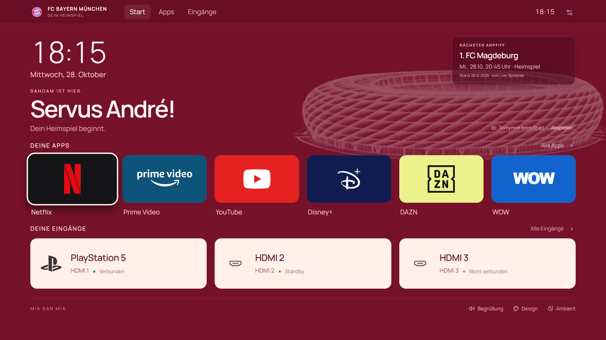

# Andrés Heimspiel für Fire TV

Android-/Fire-TV-App **0.5.0** für deinen persönlichen Bayern-Startbildschirm.
Paket: `de.andre.heimspiel`, Versionscode: `5`.

[APK 0.5.0 herunterladen](releases/Andres-Heimspiel-0.5.0.apk)



„Servus André!“, die Arena-Zeichnung, App-Favoriten und der Torhymnen-Ausschnitt
0:00–0:05 sind lokal enthalten. Die App liest installierte TV-Apps und die vom
Gerät gemeldeten HDMI-Eingänge über Android-Schnittstellen. Die Oberfläche
benötigt keine CDNs; persönliche Einstellungen bleiben auf dem Fernseher.
Für die gesprochene Begrüßung braucht das Gerät eine deutsche Systemstimme.

## Fünf Designvorlagen

Unter **Einstellungen → Design** kannst du sofort wechseln:

| Vorlage | Gestaltung |
| --- | --- |
| Dunkles Bayern | Anthrazit, dezente Arena, große Apps und Spielplan unten |
| Rot-Weiß | Sportmagazin mit kräftigem Rot, hellen Karten und Spielplan oben |
| Apple-TV-Stil | Helle Flächen, weiche Kacheln, mittige Navigation und rote Akzente |
| Bayern Lounge | Große Uhr, ruhige Arena, einheitliche Markenlogos und Gerätekarten |
| Bayern Rotglut | Dunkelroter Hintergrund, warme weiße Schrift und helle HDMI-Karten |

Die Wahl wird gespeichert. Favoriten, Gerätenamen, Begrüßung und Audio bleiben
erhalten. **Startbildschirm ansehen** zeigt die gewählte Vorlage ohne erneute
Torhymne. Der Regler **Kachelecken** erlaubt anschließend eigene Anpassungen.

Lounge und Rotglut verwenden lokale Markenlogos. Benannte PlayStation-, Xbox-
und Nintendo-Switch-Eingänge erhalten ein passendes Zeichen. Andere Apps und
Eingänge behalten ihre verfügbare Grafik beziehungsweise ein allgemeines Symbol.
Die Vorschauen verwenden Beispieldaten; die TV-App zeigt die vorhandenen Geräte.
Mehr zu den Vorlagen steht in [TEMPLATES.md](TEMPLATES.md).

## Updates direkt am Fernseher

Ab Version 0.5 gibt es **Einstellungen → Updates**:

- **APK-Datei auswählen** übernimmt eine neuere Heimspiel-APK aus der
  Dateiauswahl des Fernsehers, falls dort eine passende Dateiauswahl verfügbar ist.
- Mit einer erreichbaren **HTTPS-Onlinequelle** kannst du nach neuen Versionen
  suchen und sie herunterladen. Der Dateiweg bleibt unabhängig davon verfügbar.
- **Update installieren** öffnet nach der Dateiprüfung den Systemdialog. Dort
  bestätigst du die Installation selbst. Über **Installationsfreigabe öffnen**
  kannst du bei Bedarf die Installation unbekannter Apps für Andrés Heimspiel
  erlauben; die Menübezeichnung hängt von Fire OS ab.

Die APK muss zum selben Paket gehören, einen höheren Versionscode haben und
mit demselben Schlüssel signiert sein. Beim Online-Download wird zusätzlich die
SHA256-Prüfsumme mit der Updatebeschreibung verglichen. Ein Update über die
bestehende Installation erhält die Einstellungen.

**Der Onlinekanal ist vorbereitet, aber noch nicht anonym erreichbar.** Die
Standardadresse verweist auf das private Repository
[KALLETiER/androidtvtest](https://github.com/KALLETiER/androidtvtest). Private
GitHub-Dateien und private Release-Downloads erfordern eine Anmeldung, die der
Updater derzeit nicht unterstützt. Für Online-Updates braucht die App eine
ohne Anmeldung erreichbare HTTPS-Quelle. Die Quellenadresse lässt sich am TV
ändern; wird der vorbereitete Kanal später öffentlich erreichbar, kann sie
unverändert bleiben. Veröffentlichung und Aktivierung sind getrennte Schritte.
Eine privat heruntergeladene APK kann auch separat übertragen und über die
Dateiauswahl übernommen werden. Mehr dazu steht in [UPDATES.md](UPDATES.md).

## Erste Installation und WLAN-Update

Version 0.5 muss zunächst wie die bisherige App installiert werden. PC und TV
mit demselben Netzwerk verbinden, ADB-Debugging am TV einschalten und die
Verbindungsanfrage auf dem TV zulassen. `TV_IP` durch die Adresse des Fernsehers
ersetzen:

```powershell
adb connect TV_IP:5555
adb devices
adb install -r "Andres-Heimspiel-0.5.0.apk"
adb shell am start -n de.andre.heimspiel/.MainActivity
```

Danach findest du **Andrés Heimspiel** unter den installierten Apps. Auch
künftige Versionen können mit `adb install -r` über WLAN aktualisiert werden.
Eine Deinstallation löscht die lokalen Einstellungen und eigene Audiodateien.

Die APK verwendet eine lokale Entwicklungssignatur. Folgeversionen müssen mit
demselben Schlüssel gebaut werden, damit sie diese Installation aktualisieren
können. Schlüssel und Zugangsdaten gehören nicht in das Quellcode-Repository.

## Gerätefunktionen und Spielplan

Die App deklariert einen HOME-Intent. Ob Fire OS sie als Standardstartbildschirm
anbietet, entscheidet die Firmware. Sie ersetzt oder deaktiviert den Amazon-
Launcher nicht automatisch. Home-Taste, direkte HDMI-Umschaltung, Dateiauswahl
und Installationsdialog müssen auf dem jeweiligen Gerät geprüft werden.

HDMI verwendet die vom System gemeldeten Eingangs-IDs und Statusangaben.
Erlaubt die Firmware keinen direkten Wechsel, öffnet die App das Eingangs- oder
Systemmenü.

Der Spielplan hat den sichtbaren festen Datenstand **28.10.2026** und wird
nicht live aktualisiert. Die kompakte Karte in Lounge und Rotglut zeigt den
nächsten noch ausstehenden Anpfiff aus diesen Daten; nach deren Ablauf verweist
sie auf den offiziellen Spielplan. Dieser lässt sich jederzeit aus der App öffnen.

## Erneut bauen

Voraussetzungen: JDK 17, Android SDK mit Plattform 36 und akzeptierten
SDK-Lizenzen. `local.properties` auf den eigenen SDK-Pfad setzen. Der Wrapper
verwendet Gradle 8.13 und Android Gradle Plugin 8.13.1.

```powershell
.\gradlew.bat assembleDebug lintDebug
```

Ergebnis: `app/build/outputs/apk/debug/app-debug.apk`. Der vollständige Quellcode
und die Dokumentation liegen in diesem Projekt. Geräteprüfungen und ihre Grenzen
werden getrennt von den Funktionsbeschreibungen dokumentiert.

## Herkunft und Quellen

Die Lounge-Gestaltung ist durch [arn0-tv](https://github.com/NelsonEU/arn0-tv)
angeregt. Die App nutzt weiterhin ihre Android-Technik; Samsungs Home-Tasten-
Hilfsprogramme werden nicht übernommen. Herkunft und Lizenztexte der lokalen
Marken und Schrift liegen unter `app/src/main/assets/brands`.

- [Amazon: Verbindung per ADB](https://developer.amazon.com/docs/fire-tv/connecting-adb-to-device.html)
- [Amazon: Eingaben der Fernbedienung](https://developer.amazon.com/docs/fire-tv/ja-remote-input.html)
- [Android: TV-App vorbereiten](https://developer.android.com/training/tv/get-started/create)
- [Offizieller FC-Bayern-Spielplan](https://fcbayern.com/de/match-center/matchplan/profis)
- [Gewünschte Torhymne, Ausschnitt 0:00–0:05](https://www.youtube.com/watch?v=VjEcOidS2kQ)

Die Arena-Zeichnung entstand für den persönlichen Entwurf. Das Wappen stammt
aus dem im Entwurf verwendeten Football-Logos-Datensatz. Dies ist ein
persönlicher Fanentwurf und keine offizielle FC-Bayern-App.
